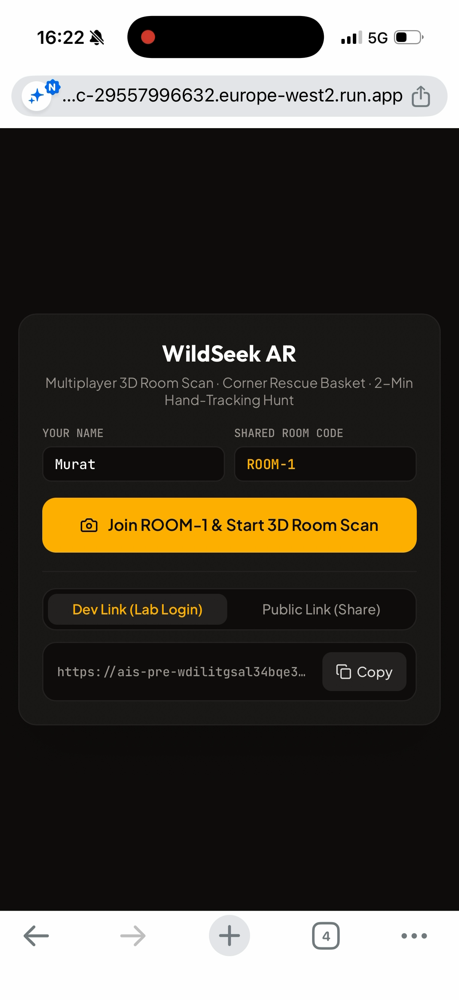
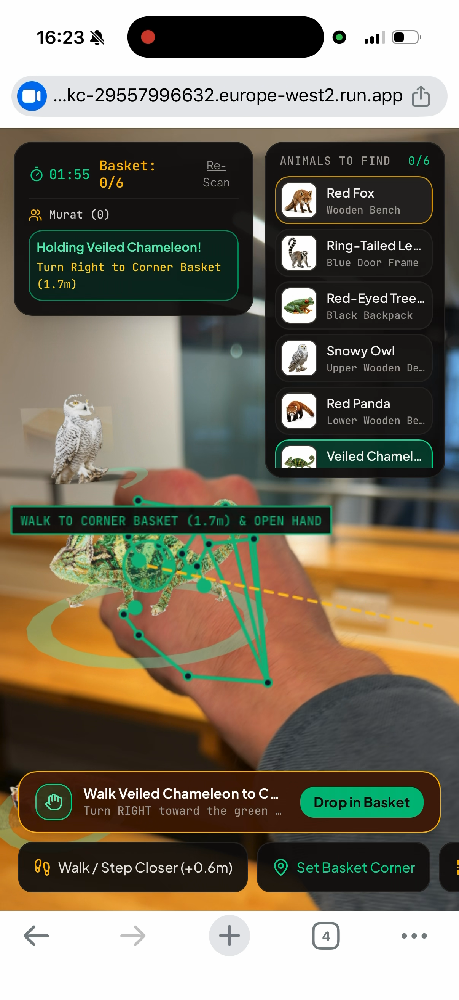
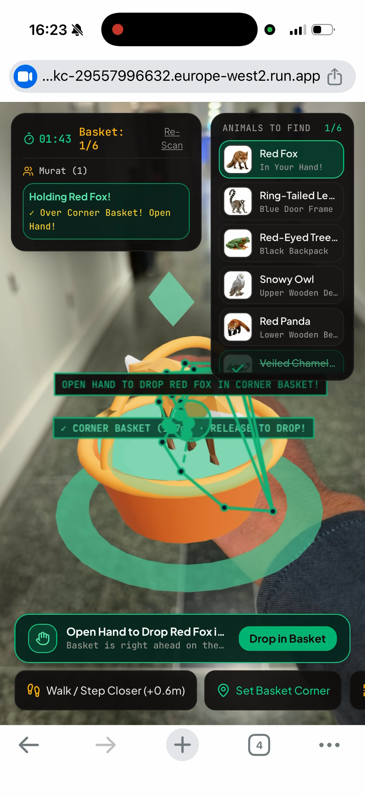
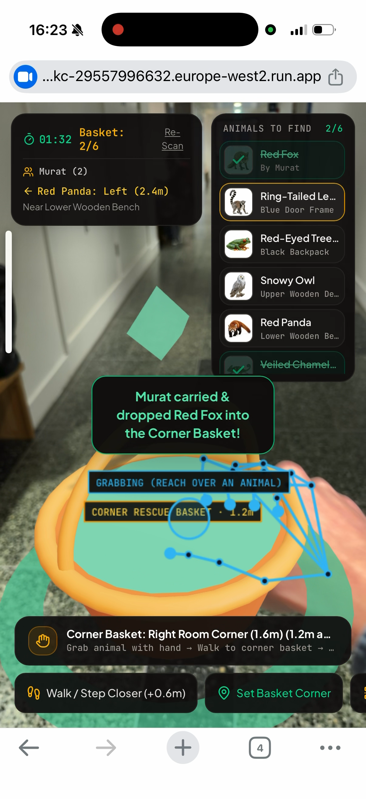
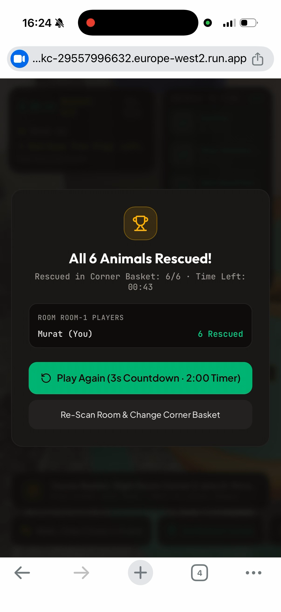
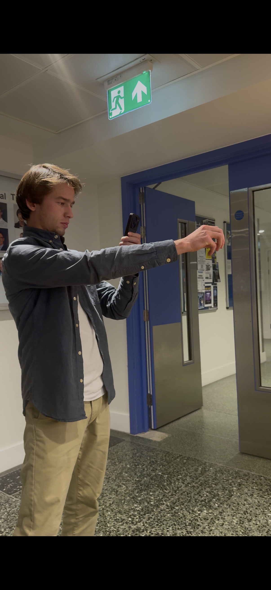

# WildSeek AR (BioLens): 3D Room Hide & Seek

A real-time multiplayer WebAR game where players scan a physical room, find **15 hidden 3D animals** on the floor, grab them using real-time **hand tracking**, and drop them into a **single shared rescue basket**.

🎥 **Gameplay Demo Video:** [Watch on iCloud](https://www.icloud.com/photos/#/icloudlinks/036gTOzETdT2J835nwObXrAfg/)

---

## App Screenshots

<table>
  <tr>
    <td align="center">
      <br />
      <sub><b>1. Join Session (Murat = Host)</b></sub>
    </td>
    <td align="center">
      <br />
      <sub><b>2. 3D Hand Grab (Chameleon)</b></sub>
    </td>
    <td align="center">
      <br />
      <sub><b>3. Carry Over Shared Basket</b></sub>
    </td>
  </tr>
  <tr>
    <td align="center">
      <br />
      <sub><b>4. Release Hand to Drop</b></sub>
    </td>
    <td align="center">
      <br />
      <sub><b>5. Match Winner Summary</b></sub>
    </td>
    <td align="center">
      <br />
      <sub><b>6. Live AR Hand Reaching</b></sub>
    </td>
  </tr>
</table>

---

## How to Play

1. **Name-Only Entry (`Murat` = Host):** Players join with just their name (no sign-up). Entering **`Murat`** automatically assigns that player as the **Room Host**; all other names join as regular players.
2. **Host Scan & 1-Tap Shared Basket:** Only the Host (`Murat`) scans the room (`0% → 90%` green floor mesh) and places the **single shared Rescue Basket** with one tap (`Drop Here`, `Left Corner`, or `Right Corner`).
3. **3s Countdown & 2-Minute Hunt:** Once the scan reaches 90%, a 3-second countdown starts a 2-minute round for everyone with **15 3D animals** hidden on the room floor.
4. **First to 5 Wins:** Reach out with your hand to pinch/grab an animal, walk to the shared basket, and open your hand to drop it in. The first player to rescue **5 animals** wins!

---

## How AI & Gemini Are Used

- **Built with Gemini 4 Argon:** The 3D spatial AR engine, procedural animal rigs, and multiplayer architecture were designed and built using **Gemini 4 Argon**.
- **In-App Gemini Vision API (`@google/genai`):** Analyzes scanned room frames on the backend (`gemini-3-flash-preview` & `gemini-3.1-flash-image-preview`) to verify floor/furniture geometry, place the 15 animals in realistic floor spots, and generate adaptive wildlife coat textures.
- **On-Device Computer Vision:** Uses **MediaPipe Hand Landmarker** for real-time 21-point 3D hand tracking (pinch/grab/release gestures) and **TensorFlow.js (`COCO-SSD`)** for live room object detection.

---

## Tech Stack

- **Frontend:** React 19, TypeScript, Three.js (WebGL 3D scene & floor-locked physics), Tailwind CSS, Vite
- **AI & Vision:** Google Gemini API (`@google/genai`), MediaPipe Hands (`@mediapipe/tasks-vision`), TensorFlow.js (`@tensorflow-models/coco-ssd`)
- **Multiplayer Server:** Node.js, Express, Server-Sent Events (SSE) for real-time room sync

---

## Quick Start

```bash
npm install
npm run dev
```
